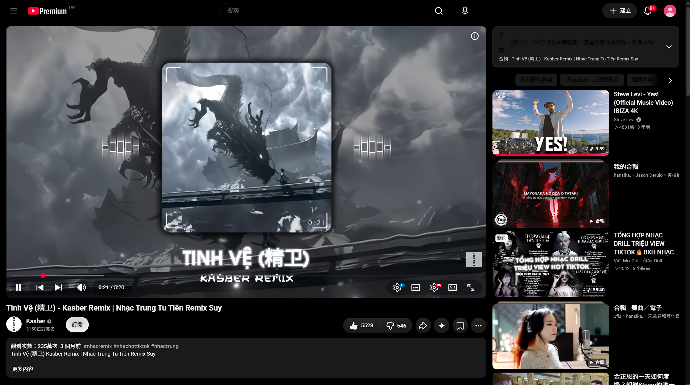
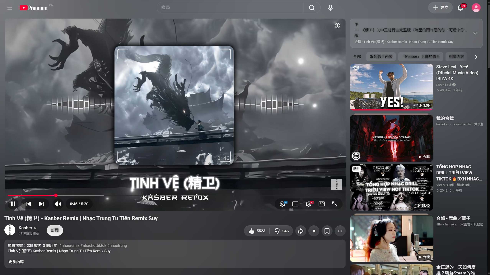
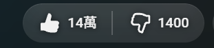

# YouTube Firefox 加強版

這是一個基於 [uBlock Origin](https://github.com/gorhill/uBlock) 的個人修改版 Firefox 外掛，主要加入 YouTube 播放、環境光與手機使用功能。

> 這不是官方 uBlock Origin，也不代表 Google、YouTube 或其他第三方專案。

## 功能

- 隱藏部分 YouTube 廣告元素
- 顯示 Return YouTube Dislike 倒讚估算
- 影片進入已知業配區段時顯示「跳過業配」
- 播放速度 `0.10x～4.00x`
- 速度滑桿、加減按鈕與常用速度按鈕
- Ambient Lite 環境光效果
- 中文控制面板
- 支援桌面 Firefox 與 Firefox Android 的相容設計

## 安裝前：先安裝 Firefox

- [下載 Windows／macOS／Linux 版 Firefox](https://www.mozilla.org/firefox/new/)
- [下載 Android 版 Firefox](https://www.mozilla.org/firefox/browsers/mobile/android/)
- [下載 iPhone／iPad 版 Firefox](https://www.mozilla.org/firefox/browsers/mobile/ios/)

本外掛主要支援桌面 Firefox 與 Android Firefox。iPhone／iPad 版 Firefox 目前不支援這類 Firefox 外掛。

## 下載外掛

<!-- 這個連結會在 GitHub Release 上傳同名 XPI 後生效。 -->

[](../../releases/latest/download/youtube-uBlock-firefox.xpi)

## 電腦版 Firefox 安裝方式

1. 按上面的按鈕下載 `.xpi` 檔案。
2. 開啟 Firefox。
3. 在網址列輸入 `about:addons`。
4. 點擊右上角的齒輪。
5. 選擇「從檔案安裝附加元件」。
6. 選擇下載的 `.xpi` 檔案。
7. 按「新增」。

如果 Firefox 顯示檔案未簽署，代表該版本還不能直接安裝，需要等待 Mozilla 簽署完成，或使用下方的開發者測試方式。

## Android Firefox 安裝方式

Android Firefox 只能安裝經 Mozilla 簽署的外掛。最新 Firefox Android 的安裝步驟如下：

1. 在手機上開啟 Firefox Android。
2. 點擊右上角的「⋮」。
3. 點擊「設定」。
4. 滑到最下面，點擊「關於 Firefox」。
5. 快速連續點擊 Firefox 圖示 5 次。
6. 返回「設定」。
7. 點擊「從檔案安裝擴充功能」。
8. 選擇下載的 `.xpi` 檔案。
9. 點擊「新增」。

如果找不到「從檔案安裝擴充功能」，或出現「無法安裝」，通常是以下原因之一：

- Firefox 版本太舊
- 外掛尚未經 Mozilla 簽署
- 外掛尚未宣告支援 Android

## 可以做什麼

安裝完成後，開啟 YouTube 影片即可使用。

### 調整播放速度

影片頁面會顯示速度控制面板：

- 點擊 `−` 讓影片變慢
- 點擊 `＋` 讓影片變快
- 拖曳滑桿調整速度
- 支援 `0.10x` 到 `4.00x`

### 跳過業配

如果影片有 SponsorBlock 業配資料，播放到業配區段時會出現「跳過業配」按鈕。點擊後會跳到業配結束位置。

這是手動跳過，不會自動跳過，也不會提交 SponsorBlock 資料。

### 顯示倒讚

影片下方會顯示 Return YouTube Dislike 提供的倒讚估算。這不是 YouTube 官方數字，可能與實際數字不同。

### 使用環境光

點擊「環境光」可以調整：

- 環境光開關
- 光暈強度
- 模糊程度
- 顏色飽和度
- 更新頻率

影片暫停或切換到其他分頁時，環境光會停止更新以節省效能。

#### Ambient Lite 使用前後

以下為 Ambient Lite 開啟前後的畫面對比：

**使用前：**



**使用後：**



### 倒讚估算顯示

影片下方會顯示 Return YouTube Dislike 提供的倒讚估算：



## 已知限制

- 只處理部分 YouTube 廣告元素，不保證永久有效
- SponsorBlock 只處理影片內已知業配，不處理 YouTube 前置廣告
- 倒讚數是估算值，不是官方數字
- Ambient Lite 會增加 GPU 使用量，低階手機可能需要降低更新頻率
- iPhone／iPad 版 Firefox 不支援本外掛
- 目前尚未提供影片下載功能
- Android 實機相容性仍在測試中

## 隱私

- Ambient Lite 只在本機取樣影片畫面
- 不會上傳影片畫面
- SponsorBlock 只查詢影片區段資料
- Return YouTube Dislike 只查詢倒讚資料
- 不提供登入、投票或使用行為分析

## 開發者測試

如果下載的 XPI 尚未簽署，可以在電腦 Firefox 暫時載入原始碼：

1. 下載或複製本 repository。
2. 開啟 Firefox 的 `about:debugging`。
3. 點擊「此 Firefox」。
4. 點擊「載入暫時附加元件」。
5. 選擇專案中的 `platform/firefox/manifest.json`。

建置需要 Node.js 與 WSL/Linux 環境：

```bash
npm ci
make dist/build/uAssets
bash tools/make-firefox.sh
```

## 授權與出處

本專案基於 uBlock Origin，使用 GPLv3 或後續版本授權。

第三方專案、API 與授權資訊請查看 [THIRD-PARTY-NOTICES.txt](THIRD-PARTY-NOTICES.txt) 與 [LICENSE.txt](LICENSE.txt)。
